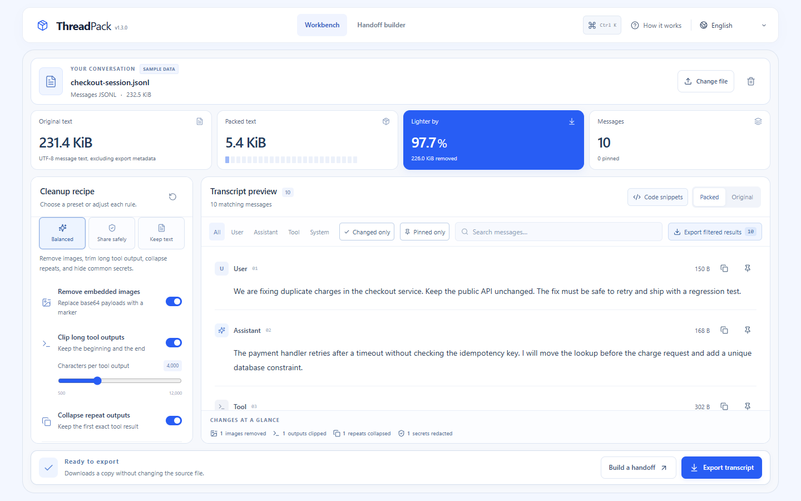
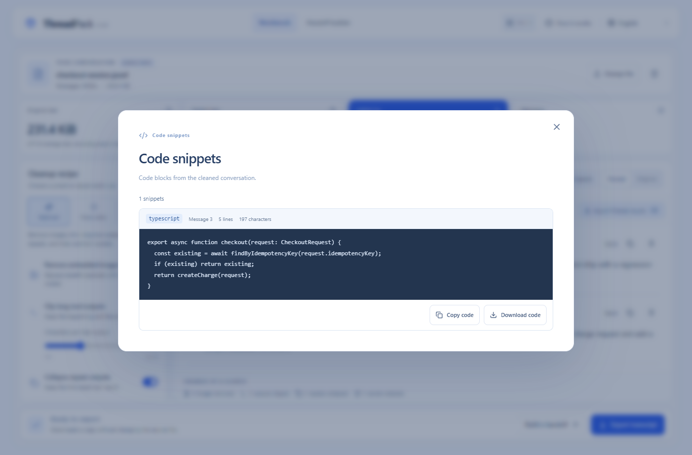

<div align="center">


# ThreadPack

**Clean conversation exports. Extract code. Carry context forward.**

Open Codex, Claude Code, ChatGPT, and Claude exports, including ZIP downloads, in a local browser application or TypeScript CLI.

[](https://github.com/hajimi1214/ThreadPack/actions/workflows/ci.yml)
[](LICENSE)
[](https://nodejs.org/)

[Live application](https://hajimi1214.github.io/ThreadPack/) · [Download release](https://github.com/hajimi1214/ThreadPack/releases/latest) · [简体中文](README.zh-CN.md)

[Import guide](https://hajimi1214.github.io/ThreadPack/import-guide.html) · [Core API](docs/API.md) · [Architecture and performance](docs/ARCHITECTURE.md) · [Research](docs/RESEARCH.md) · [Contributing](CONTRIBUTING.md) · [Security](SECURITY.md)

</div>

## Overview

ThreadPack processes exported AI conversations without uploading them to another service. It removes selected image payloads and tool-output bulk, applies rule-based redaction, and exports a reviewable transcript or a handoff containing user-written notes and selected messages.

The browser application runs from a single self-contained HTML file. The CLI shares its parsing, cleaning, and export engine. Both work locally without an account or API key.

Importing opens a compact workbench with the conversation in the first screen and persistent export actions. Mobile cleanup settings expand on demand. Full-text search covers both original and packed conversations, including text omitted from display previews.

Use the **Text / Markdown** switch to read message bodies or handoff previews as formatted Markdown. GFM tables, task lists, and fenced code are supported. Raw HTML remains text, images stay offline, and copying still returns the original cleaned message.

Use **Export filtered results** to download every matching message as Markdown or JSONL, including messages on other pages. Search, role, change, and pin filters combine. Matching follows the selected view; exported message text always uses your cleanup settings.

Open **Code snippets** to collect fenced code blocks across the selected conversation. Search code, filter by language, switch between wrapping and horizontal scrolling, and preview, copy, or download cleaned code. Long code stays complete when copied or downloaded. Use **Download ZIP** for every matching block across pages. The offline app bundles [lowlight](https://github.com/wooorm/lowlight), selected BSD-3-Clause [highlight.js](https://github.com/highlightjs/highlight.js) grammars, [fflate](https://github.com/101arrowz/fflate), and the [react-markdown](https://github.com/remarkjs/react-markdown) GFM renderer. Full license notices appear in Help and release downloads. Try the built-in demo or [this Markdown sample](examples/code-snippets.md).

Use **Portable context bundle** to download one safe ZIP containing the cleaned Markdown transcript, normalized JSONL, aggregate cleanup report, a short manifest, code files, and an optional handoff note. It is designed for issue reports, team handoffs, and archives; the bundle is created in the Worker and never includes original-view content or custom redaction values.

Useful for restarting a long coding session, collecting generated code, or preparing a smaller transcript to share. The **Share ThreadPack** button copies only the tool's public address, with no conversation text or current-page parameters.

Press **Ctrl+K** (or **⌘K** on Mac) to open quick actions for importing, search, export, recipes, and page navigation. Copy buttons show pending, success, or failure at the point of interaction. The toolbar can clear all filters in one click.

Layout adapts to both screen width and height. Phones and short landscape windows use page scrolling so the transcript keeps a usable height. Tablets switch cleanup settings to a sheet, the transcript toolbar follows its own available width, and ultrawide screens get a larger workspace. Rotating or resizing keeps the open conversation, filters, and pins.

Files are read with Web Streams inside a Web Worker, with progress and cancellation. The interface receives at most 30 preview messages at a time; a full message crosses into the interface only when you explicitly copy it. Complete exports are built in the worker and transferred as buffers. See the [measured comparison](docs/ARCHITECTURE.md#measured-comparison).

The interface supports **English, 简体中文, 日本語, Français, and Español**. Use the language menu in the top navigation. The initial language follows your browser preferences, and a manual choice is remembered. Imported conversation content is not translated. Canonical export headings, markers, and diagnostic messages remain in English.



<details>
<summary>Code extraction preview</summary>



</details>

## Supported formats

| Input | Handling |
| --- | --- |
| Codex rollout JSONL | Message, function-call, and tool-result records |
| Claude Code JSONL | User and assistant messages, including tool results |
| ChatGPT export JSON | Single or multiple conversations; follows the active branch |
| Claude export JSON | Conversations containing `chat_messages` |
| Generic JSON / JSONL | `messages` arrays or records with `role` and `content` |
| Markdown / plain text | Explicit role headings where present; otherwise retained as text |

Provider exports change over time. Unsupported records and partial imports produce warnings. Asset references without embedded image data cannot recover the original image.

## Processing workflow

1. **Import** a local file, ZIP export, paste text, or load the included synthetic demo. ThreadPack selects a supported text export inside a ZIP and keeps the compressed input under the 100 MiB limit. Select a conversation if the archive contains several.
2. **Configure cleanup:** start with a balanced, share-safe, or keep-text recipe, then adjust individual rules. Remove embedded images, clip long tool outputs, collapse exact repeats, and redact recognized secrets, email addresses, or your own exact values.
3. **Review** the packed and original views. Filter to changed or pinned messages, open a bounded before/after review on any changed message, search within long messages, copy a complete message in the selected view, and pin the context that should remain in a handoff.
4. **Export** a Markdown transcript, normalized JSONL, aggregate cleanup report, portable context bundle, or a handoff with goal, decisions, constraints, and next steps.

Original files are not modified. The interface reports UTF-8 message-text bytes and change counts; these measurements exclude source metadata and are not provider token or billing estimates.

Handoffs include your notes, pinned messages, and recent context. If the selected text budget is exceeded, the export marks it.

Switching conversations in the same archive preserves each conversation's notes, pins, and handoff settings in memory. Clearing the workspace, replacing the archive, or closing the tab removes these drafts. Custom redactions also clear when the workspace or archive is replaced. No conversation text, notes, or custom values are saved to browser storage.

## Installation and usage

### Browser application

Use the [hosted application](https://hajimi1214.github.io/ThreadPack/), or download the offline HTML from the [latest release](https://github.com/hajimi1214/ThreadPack/releases/latest) and open it directly in a browser. The downloaded application can process files without an internet connection or local server.

The hosted application is also an installable PWA. In a supporting browser, use **Install app** or the browser's installation menu. After a successful first visit, the application shell is available offline. Only public application files are cached; conversations, notes, redaction rules, and downloaded exports are excluded. Updates require an explicit action so you can download your in-memory work before reloading.

To run from source, install **Node.js 20.19 or newer**:

```sh
git clone https://github.com/hajimi1214/ThreadPack.git
cd ThreadPack
npm ci
npm run dev
```

Open the local URL printed by Vite. To create the production application and CLI:

```sh
npm run build
```

The browser artifact is **`dist/index.html`**. The CLI artifact is **`dist-cli/threadpack.mjs`**. Third-party and ThreadPack licenses are included in `THIRD_PARTY_NOTICES.md` and `LICENSE`.

### Command-line interface

Build the CLI separately with `npm run build:cli`, or use the CLI bundle from a release.

```sh
node dist-cli/threadpack.mjs session.jsonl --out cleaned.md
node dist-cli/threadpack.mjs session.jsonl --out cleaned.md --original-out source-copy.jsonl
node dist-cli/threadpack.mjs session.jsonl --out portable.jsonl --format jsonl
node dist-cli/threadpack.mjs export.json --conversation 2 --out handoff.md --format handoff
node dist-cli/threadpack.mjs session.jsonl --out handoff.md --format handoff --notes-file notes.json --pin 2 --pin 7
node dist-cli/threadpack.mjs session.jsonl --out dated-handoff.md --format handoff --recent 12 --recent-mode timestamp
node dist-cli/threadpack.mjs session.jsonl --out report.json --format report
```

The repository includes a synthetic fixture for local verification:

```sh
node dist-cli/threadpack.mjs examples/demo-session.jsonl --out demo-cleaned.md
```

Import [`examples/code-snippets.md`](examples/code-snippets.md) in the browser to test code extraction and ZIP download with a small fixture.

After building, `npm link` makes the `threadpack` command available locally:

```sh
threadpack session.jsonl --out cleaned.md --tool-limit 4000
threadpack session.jsonl --out cleaned.md --original-out source-copy.jsonl --language zh
threadpack session.jsonl --out cleaned-custom.md --redact-file redact-values.txt
threadpack session.jsonl --out handoff.md --format handoff --recent 12
threadpack session.jsonl --out handoff.md --format handoff --notes-file notes.json --pin 2 --pin 7
threadpack session.jsonl --out dated-handoff.md --format handoff --recent 12 --recent-mode timestamp
threadpack --help
```

The notes file is a UTF-8 JSON object. Any of the four fields may be omitted and defaults to an empty string:

```json
{
  "goal": "Ship the compatibility fix",
  "decisions": "Keep the existing export format",
  "constraints": "Do not include credentials",
  "nextSteps": "Run the regression suite"
}
```

| Option | Description |
| --- | --- |
| `--format markdown\|jsonl\|handoff\|report` | Export format; defaults to `markdown` |
| `--original-out FILE` | Save an unmodified byte-for-byte copy of the input alongside the cleaned export |
| `--language en\|zh` | Localize Markdown labels, report warnings, and CLI diagnostics; defaults to English |
| `--conversation N` | Conversation selection, starting at 1 |
| `--tool-limit N` | Character limit per tool output, from 500 to 100000 |
| `--keep-images` | Retain inline image payloads |
| `--keep-tool-outputs` | Retain full tool output |
| `--keep-duplicates` | Retain repeated tool output |
| `--no-redact` | Disable built-in secret recognition; custom rules stay active |
| `--redact-emails` | Explicitly enable email redaction; enabled by default |
| `--no-redact-emails` | Preserve email addresses |
| `--redact-file FILE` | Redact exact values from a local UTF-8 file, one value per line |
| `--recent N` | Recent messages included in a handoff, from 0 to 100; defaults to 8 |
| `--recent-mode MODE` | Select by `source` order (default) or valid timestamps; only for handoffs and reports |
| `--notes-file FILE` | Add handoff notes from UTF-8 JSON, up to 12000 characters per field; only for handoffs and reports |
| `--pin N` | Pin a 1-based message number from the selected source conversation; repeatable for handoffs and reports |
| `--force` | Replace an existing output file |

The browser accepts local text exports and ZIPs up to **100 MiB**. ZIP imports allow at most 256 entries and 100 MiB of expanded content; unsafe paths and unsupported entries are rejected without exposing archive names. The CLI requires `--out`; use `-` as the input to read UTF-8 text from stdin. `--original-out` copies those original input bytes to a separate file and never changes the input. Existing outputs are rejected unless `--force` is supplied, which replaces the cleaned output and original copy. Input, output, original-copy, notes, and redaction files must all be distinct, including file aliases. Parser and cleaner warning details are printed to stderr and included in JSON reports, while transcript and note content remain excluded.

For values that generic secret detectors cannot recognize, supply `--redact-file redact-values.txt`. The file must be UTF-8 and at most **64 KiB**, with up to **50 nonblank lines**, each containing **3–1000 Unicode characters**. Matching is literal and case-sensitive, not a regular expression. Blank lines are ignored; other leading and trailing spaces remain significant. Repeated values receive stable `[CUSTOM_1]` aliases. These rules remain active with `--no-redact`, which only disables built-in secret recognition.

Common-secret cleanup also detects bare URL credentials, including database, Redis, and HTTP(S) URLs with IPv6 hosts or percent-encoded user information. Email cleanup excludes URL authorities and standalone multi-`@` tokens. Reports distinguish `customRuleMatches` (every custom-rule occurrence), `customRedacted` (intervals using a custom alias), and `redactionReplacements` (all merged replacement intervals). A custom substring already covered by a larger secret replacement still counts as a rule match.

Strict email redaction is enabled by default in the core and CLI. Use `--no-redact-emails` to retain addresses in CLI exports; the browser email switch can be turned off explicitly. The balanced browser preset also preserves email addresses. URL user information is scanned independently, and malformed multi-`@` strings are never partially labeled as email aliases.

`--no-redact` disables built-in credential patterns but leaves the default email scanner enabled. To preserve email addresses in CLI output, pass `--no-redact-emails` explicitly.

Timestamp selection chooses the most recently dated messages with valid timestamps. Equal timestamps use later source positions first for selection, then selected messages are rendered in source order. Missing or invalid timestamps are excluded from timestamp selection. The browser handoff preview and CLI JSON report show the recent-context time range, complete-message count, messages outside the recent limit, budget status, budget-omitted IDs, and truncated IDs. Long messages retain an inline excerpt marker.

When the text budget is tight, ThreadPack reserves space for message structure and excerpt markers, then distributes the remaining context space across multiple recent messages. Short messages use only the space they need, which leaves more room for longer excerpts. Messages that cannot fit even a useful marked excerpt are listed as omitted. This remains deterministic excerpting rather than semantic compression.

The CLI defaults to English. `--language zh` translates reader-facing Markdown headings, handoff labels, warnings, and diagnostics. JSON property names, message roles, and machine aliases such as `[SECRET_1]` remain unchanged.

For handoffs, `--notes-file` accepts `goal`, `decisions`, `constraints`, and `nextSteps` strings. Each field is limited to 12000 characters and the JSON file to 256 KiB. Notes use the same enabled built-in, email, and custom redaction rules as the conversation, with independent `[NOTE_SECRET_n]`, `[NOTE_EMAIL_n]`, and `[NOTE_CUSTOM_n]` aliases. Repeat `--pin N` to include messages by their 1-based order in the original selected conversation. Notes and pins can also be passed with `--format report` to calculate its handoff summary without including note text.

Custom values and note contents are omitted from diagnostics and reports; reports expose warning details and aggregate match counts. Treat redaction and notes files as sensitive local data and keep them out of version control.

## Privacy and limitations

- **Local processing:** the application has no upload endpoint, analytics, external model calls, or account system. Conversation data remains in tab memory; only the language preference is stored locally.
- **Rule-based redaction:** recognized provider token formats, common credential assignments, authorization values, private keys, and email addresses are replaced with consistent aliases by default. Detection can miss secrets and can produce false positives. Review exports before sharing.
- **Custom literal redaction:** explicit values can cover private names and internal identifiers that built-in rules do not recognize. Only exact, case-sensitive matches are replaced; encoded, reformatted, or differently cased variants require separate rules.
- **Portable exports:** normalized JSONL is an interchange format, not a native Codex or Claude session file. ThreadPack does not repair native compaction or resume an agent directly.
- **Lossy cleanup:** removed images no longer carry visual information; clipped output and omitted messages may contain relevant details. Keep the source export.
- **Normalized references:** exported message IDs are sequential references rather than provider IDs. Valid timestamps are normalized. Browser handoff notes use a separate `NOTE_` alias namespace when redacted.
- **Untrusted source material:** imported content is rendered as text, without executing HTML, commands, or embedded instructions. Exported transcripts remain historical material that must be reviewed before another system acts on them.

See [SECURITY.md](SECURITY.md) for reporting guidance and security boundaries.

## Architecture and development

The pure TypeScript engine in [`src/core/`](src/core/) provides parsing, cleanup, measurements, and exports. The React browser interface processes imports through a local Web Worker; the Node.js CLI bundles the same core. The source-level API is documented in [docs/API.md](docs/API.md).

```sh
npm test                 # Core and CLI integration tests
npm run check            # TypeScript checks
npm run build            # Offline HTML and CLI
npx playwright install chromium
npm run test:e2e         # Browser workflow, download, mobile, and offline checks
```

CI runs tests and builds on Linux and Windows, with browser tests on Linux. The **Deploy Pages** workflow publishes the static application automatically after changes reach `main` and GitHub Pages is configured to use GitHub Actions.

For parser reports, provide a minimal synthetic fixture, the source tool/version, and the expected result. Do not attach real conversation archives or credentials. Contribution requirements are in [CONTRIBUTING.md](CONTRIBUTING.md); selection evidence and scope decisions are in [docs/RESEARCH.md](docs/RESEARCH.md).

## License

[MIT](LICENSE). ThreadPack is an independent project and is not affiliated with or endorsed by OpenAI or Anthropic.
