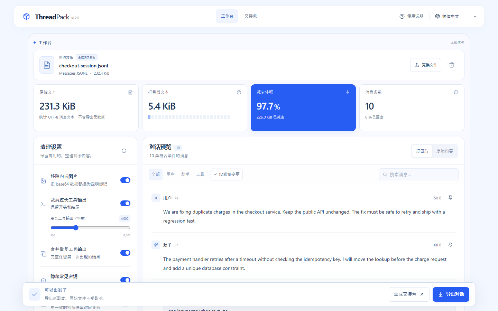

<div align="center">


# ThreadPack

**本地 AI 对话处理工具**

通过浏览器应用或共用核心引擎的 TypeScript CLI，检查、清理和导出 AI 对话文件。

[](https://github.com/hajimi1214/ThreadPack/actions/workflows/ci.yml)
[](LICENSE)
[](https://nodejs.org/)

[在线应用](https://hajimi1214.github.io/ThreadPack/) · [下载发布版本](https://github.com/hajimi1214/ThreadPack/releases/latest) · [English](README.md)

[核心 API](docs/API.md) · [架构与性能](docs/ARCHITECTURE.md) · [需求调研](docs/RESEARCH.md) · [贡献指南](CONTRIBUTING.md) · [安全说明](SECURITY.md)

</div>

## 项目概述

ThreadPack 在本地处理 AI 对话导出文件，无需上传到其他服务。它可以按设置移除图片数据、裁剪和合并工具输出，执行规则脱敏，并导出可检查的记录，或包含用户笔记和选定消息的交接包。

浏览器产物是一个自包含 HTML 文件。命令行与网页共用解析、清理和导出引擎。两种方式均不需要账号、API Key、后端或大模型。

导入后直接进入紧凑工作台，首屏显示对话，导出操作保持可见；手机端按需展开清理设置。全文搜索覆盖原始与打包后的完整对话，也能找到预览未显示的中间文字。

文件通过 Web Streams 在 Web Worker 后台读取，提供进度与取消操作。界面只接收当前页最多 30 条消息；完整导出在后台生成，再通过缓冲区转移到页面。参见[实测数据](docs/ARCHITECTURE.md#measured-comparison)。

界面支持 **简体中文、English、日本語、Français 和 Español**。通过顶部语言菜单切换；首次打开会参考浏览器语言，手动选择后会记住偏好。界面切换不会翻译对话内容；规范化导出的标题、标记与诊断信息仍使用英文。



## 支持的格式

| 输入 | 处理方式 |
| --- | --- |
| Codex rollout JSONL | 消息、函数调用和工具结果记录 |
| Claude Code JSONL | 用户与助手消息，包含工具结果 |
| ChatGPT 导出 JSON | 单会话或多会话档案，沿当前分支提取 |
| Claude 导出 JSON | 包含 `chat_messages` 的会话 |
| 通用 JSON / JSONL | `messages` 数组，或具有 `role` 和 `content` 的记录 |
| Markdown / 纯文本 | 按显式角色标题分段；没有标题时保留为文本 |

服务商导出结构可能变化。不支持的记录和不完整导入会产生警告。仅有资源引用、没有内嵌图片数据的记录，无法恢复原始图片。

## 处理流程

1. **导入：**选择本地文件、粘贴文字，或加载内置合成演示。多会话档案可以切换会话。
2. **设置清理：**移除内嵌图片，裁剪过长工具输出并保留头尾，合并完全重复的工具输出，隐藏可识别的秘密，并按需对邮箱或自定义精确值脱敏。
3. **检查：**切换原始与打包后视图，只看发生变更的消息，查看具体清理标签，在长消息中定位搜索结果，并固定需要带入交接包的上下文。
4. **导出：**选择 Markdown、规范化 JSONL、汇总清理报告，或包含目标、决定、约束与下一步的交接包。

原始文件不会被修改。界面统计 UTF-8 消息文本的字节数及变化数量，不包含导出元数据，也不代表服务商的 token 用量或计费。

交接包使用确定性摘录，不推断决定，不生成 AI 摘要。用户笔记和固定消息会完整保留；超出所选预算时，输出会明确提示。

在同一档案内切换会话，会保留各自的笔记、固定消息与交接设置。这些草稿仅在内存中保留，清空、更换档案或关闭页面后移除。清空或更换档案也会清除自定义脱敏值。对话、笔记和自定义值不会写入浏览器存储。

## 安装与使用

### 浏览器应用

直接使用[在线应用](https://hajimi1214.github.io/ThreadPack/)，或从[最新发布版本](https://github.com/hajimi1214/ThreadPack/releases/latest)下载离线 HTML 后用浏览器打开。下载版无需联网或启动本地服务器即可处理文件。

在线应用也支持安装为 PWA。在支持的浏览器中点击“安装应用”或使用浏览器的安装菜单。首次成功访问后，可以离线打开。缓存仅包含公开网页资源，不包含对话、笔记、脱敏规则或导出文件。更新需要主动点击，便于你在重载前下载内存中的工作成果。

从源码运行需要 **Node.js 20.19 或更高版本**：

```sh
git clone https://github.com/hajimi1214/ThreadPack.git
cd ThreadPack
npm ci
npm run dev
```

打开 Vite 输出的本地地址。生成生产网页和 CLI：

```sh
npm run build
```

网页产物为 **`dist/index.html`**，命令行产物为 **`dist-cli/threadpack.mjs`**。

### 命令行

可使用 `npm run build:cli` 单独构建 CLI，也可以使用发布版本中的命令行文件。

```sh
node dist-cli/threadpack.mjs session.jsonl --out cleaned.md
node dist-cli/threadpack.mjs session.jsonl --out portable.jsonl --format jsonl
node dist-cli/threadpack.mjs export.json --conversation 2 --out handoff.md --format handoff
node dist-cli/threadpack.mjs session.jsonl --out report.json --format report
```

仓库提供了可用于本地验证的合成样例：

```sh
node dist-cli/threadpack.mjs examples/demo-session.jsonl --out demo-cleaned.md
```

构建后执行 `npm link`，即可在本机使用 `threadpack` 命令：

```sh
threadpack session.jsonl --out cleaned.md --tool-limit 4000 --redact-emails
threadpack session.jsonl --out cleaned-custom.md --redact-file redact-values.txt
threadpack session.jsonl --out handoff.md --format handoff --recent 12
threadpack --help
```

| 参数 | 说明 |
| --- | --- |
| `--format markdown\|jsonl\|handoff\|report` | 导出格式，默认 `markdown` |
| `--conversation N` | 选择会话，从 1 开始 |
| `--tool-limit N` | 单条工具输出的字符上限，范围 500–100000 |
| `--keep-images` | 保留内嵌图片数据 |
| `--keep-tool-outputs` | 保留完整工具输出 |
| `--keep-duplicates` | 保留重复工具输出 |
| `--no-redact` | 关闭内置秘密识别，自定义规则仍生效 |
| `--redact-emails` | 同时替换邮箱地址 |
| `--redact-file FILE` | 从本地 UTF-8 文件读取精确脱敏值，每行一个 |
| `--recent N` | 交接包中的近期消息数，范围 0–100 |
| `--force` | 替换已存在的输出文件 |

网页和 CLI 的输入上限均为 **100 MiB**。CLI 必须指定 `--out`；输入写为 `-` 时从 stdin 读取 UTF-8 文本。已有输出默认拒绝覆盖，除非显式传入 `--force`；输入文件及其别名始终受覆盖保护。终端诊断只输出汇总数量，不打印对话原文。

对于通用规则无法识别的内容，可使用 `--redact-file redact-values.txt`。规则文件必须为 UTF-8，最多 **64 KiB**，包含至多 **50 个非空白行**，每项 **3–1000 个 Unicode 字符**。按字面值区分大小写匹配，不使用正则表达式。纯空白行被忽略，其他行的首尾空格有意义，会保留。重复值使用一致的 `[CUSTOM_1]` 别名；即使传入 `--no-redact`，自定义规则仍然生效，该开关只关闭内置秘密识别。

输入、输出和规则文件必须互不相同，包括文件别名；`--force` 也不能覆盖规则文件。终端诊断和清理报告不包含自定义值或规则文件路径，报告仅记录匹配数量。规则文件本身应按敏感本地资料保管，不要提交到版本控制。

## 隐私与限制

- **本地处理：**没有上传接口、分析埋点、外部模型调用或账号系统。对话仅保存在标签页内存中，只有语言偏好写入本地存储。
- **规则脱敏：**对部分已知服务商 token、常见凭据赋值、授权值、私钥及可选邮箱地址使用一致别名。可能漏检或误判，分享前应检查导出结果。
- **自定义精确脱敏：**可以补充内置规则无法识别的私有名称或内部编号。仅替换区分大小写的精确匹配；编码、格式或大小写不同的内容需要单独提供规则。
- **交换格式：**规范化 JSONL 不是 Codex 或 Claude 的原生会话文件，不能直接恢复代理会话；ThreadPack 不修复原生上下文压缩。
- **有损清理：**移除图片后不再保留其视觉信息；裁剪和省略的内容可能仍有价值，应保留原始导出文件。
- **规范化引用：**导出消息使用顺序编号，不保留服务商原生 ID；合法时间戳会被规范化。网页交接笔记脱敏时使用独立的 `NOTE_` 别名前缀。
- **不可信来源：**导入内容作为文本展示，不执行其中的 HTML、命令或指令。导出的记录仍然是历史材料，交给其他系统执行前需要核对。

安全边界与漏洞反馈方式见 [SECURITY.md](SECURITY.md)。

## 架构与开发

[`src/core/`](src/core/) 是纯 TypeScript 引擎，负责解析、清理、测量和导出。React 网页通过本地 Web Worker 处理导入；Node.js CLI 打包同一核心。源码级接口见 [docs/API.md](docs/API.md)。

```sh
npm test                 # 核心和 CLI 集成测试
npm run check            # TypeScript 检查
npm run build            # 离线 HTML 和 CLI
npx playwright install chromium
npm run test:e2e         # 浏览器流程、下载、移动端和离线检查
```

CI 在 Linux 和 Windows 上运行测试与构建，并在 Linux 上运行浏览器测试。仓库提供手动触发的 **Deploy Pages** 工作流，需要先将 GitHub Pages 来源设置为 GitHub Actions。

反馈格式问题时，请提供最小合成样例、来源工具版本和预期结果，不要上传真实会话或凭据。贡献要求见 [CONTRIBUTING.md](CONTRIBUTING.md)，选题证据与范围决策见 [docs/RESEARCH.md](docs/RESEARCH.md)。

## 许可证

[MIT](LICENSE)。ThreadPack 为独立项目，与 OpenAI、Anthropic 无隶属或官方认可关系。
