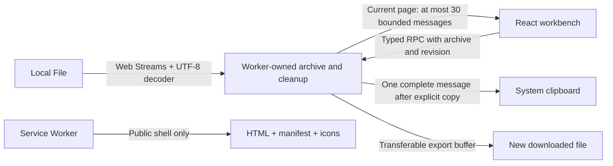

# Browser architecture

ThreadPack uses browser platform APIs to keep interaction responsive while processing local exports. The same parser and cleanup core remains available to the CLI.

The page sends the `File` to the worker, which reads bytes incrementally and reports progress. UTF-8 decoding preserves characters split across chunks. Parsing still operates on the decoded text; this is not a streaming JSON parser and does not make memory usage independent of file size. The 100 MiB limit remains.

Archive identifiers distinguish accepted files from cancelled candidate imports. Cleanup revisions identify an exact immutable recipe result. Queries, exports, and handoffs require that revision; stale requests cannot silently use a different cleanup configuration. React also checks the matching recipe and request generation before accepting responses.

Both original and packed search run over complete worker-owned message bodies. The interface receives only the requested page, with long content replaced by bounded previews. Export and handoff generation use complete retained messages in the worker rather than reconstructing content from the preview. An explicit per-message copy request returns that single complete message in the selected original or packed mode. Pinned-only filtering is combined with role, changed-message, and text filters in the worker. `ArrayBuffer` export responses transfer ownership instead of structured-cloning the buffer. React's deferred query value avoids putting search work on the input event path.

## Measured comparison

Recorded on 2026-11-19 using Windows and installed Chrome, with the same synthetic 1,000-message export (2,453,404 UTF-8 bytes). The response comparison counts the cleanup response plus the first 30-message query response; it excludes parse metadata, progress, handoff, and browser protocol overhead.

| Measurement | 1.1.0 | 1.2.0 |
| --- | ---: | ---: |
| Cleanup and initial preview response bytes | 4,964,064 | 76,664 |
| Full original and cleaned message arrays sent to React | 2,000 messages | None |
| First preview page | Rendered 30 after receiving full arrays | Receives at most 30 bounded messages |
| Desktop first message top, 1440 × 900 | 917 px | 536 px |
| Mobile first message top, 390 × 844 | 1,911 px | 620 px |

The new cleanup summary was 504 bytes and the first query response 76,160 bytes: approximately **98.46% fewer response bytes** for this fixture. This measures a concrete transfer-size reduction, not a universal runtime speedup. Real export shapes and message lengths vary.

Original-mode search was verified against a marker in the middle of a 39,250-character message. A 61-message pagination check verified that advancing a page resets the preview's scroll position to zero.

## Offline application shell

The production build still contains a standalone `index.html`. Hosted builds additionally include a manifest, Service Worker, and two installation icons. A supporting browser may install this as a PWA; `file://` builds skip registration.

The Service Worker caches an exact allowlist of public application URLs. It bypasses query strings, non-GET requests, API paths, user files, blob URLs, and other origins. Navigation tries the network and falls back to the cached HTML when offline. Cache identities include application scope, package version, and the finalized HTML hash. Only old caches for this application scope are removed.

Updates wait for an explicit user action and reload only the requesting tab. Conversation bodies, drafts, custom values, and downloaded exports are not written to Cache Storage, IndexedDB, or localStorage. Only language preferences are stored locally; application shell resources are stored separately by the Service Worker.
