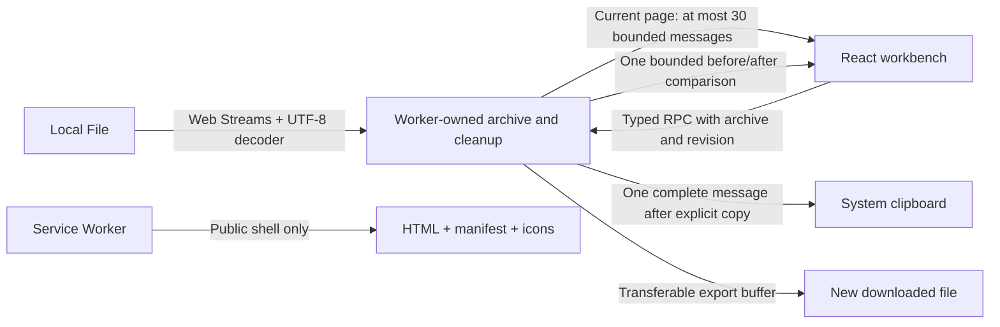

# Browser architecture

ThreadPack uses browser platform APIs to keep interaction responsive while processing local exports. The same parser and cleanup core remains available to the CLI.

The page sends the `File` to the worker, which reads bytes incrementally and reports progress. UTF-8 decoding preserves characters split across chunks, and known source byte lengths flow into the parser to avoid re-encoding the complete input for statistics. JSONL records are parsed one line at a time without retaining a second array of source lines and parsed records. Parsing still operates on the decoded text; this is not a streaming JSON parser and does not make memory usage independent of file size. The 100 MiB limit remains.

Archive identifiers distinguish accepted files from cancelled candidate imports. Cleanup revisions identify an exact immutable recipe result. Queries, exports, and handoffs require that revision; stale requests cannot silently use a different cleanup configuration. React also checks the matching recipe and request generation before accepting responses.

The core model gives every message a normalized local ID and retains provider message IDs, record positions, record types, original timestamps, and parent references in provenance. Tool-call and tool-result IDs are normalized into local links, with provider call IDs kept separately. ChatGPT exports retain their complete mapping graph and branch paths, including nodes without a message body, in worker-owned archive history; the legacy conversation message list remains the selected `current_node` path. Non-message provider records remain timeline events. Integrity summaries report stable issue codes and counts without echoing source content or identifiers, and are included in CLI/browser cleanup reports.

Normalized JSONL remains ordinary message-per-line JSONL for conversations without a branch graph, timeline events, or partial-import issues, with optional provenance fields. Conversations with branch history, timeline events, or partial integrity use a versioned ThreadPack session header plus message and event records. Import validates that envelope and remaps its IDs through the same normalized-ID and integrity checks used for provider inputs.

Preview queries and filtered exports share filter validation and matching inside the Worker. A filtered export matches all messages against the requested view, then resolves those message IDs against the cleaned result. It returns a transferable buffer and a count, without moving the full corpus into React. This also prevents an Original-view search from bypassing cleanup on export.

Copy and export controls retain their pending and completion states. Export operations use their own generation so replacing a file cannot leave a newer workspace busy or accept an older result. Handoff copy feedback is scoped to the selected conversation, cleanup revision, notes, and generated text. The command menu uses a searchable ARIA combobox, keyboard navigation, focus restoration, and the same action handlers as the visible controls.

Responsive layout uses CSS container queries for the transcript toolbar, viewport width/height media queries for the shell, dynamic viewport units, and safe-area insets. A compact or short window uses normal document scrolling and retains a bounded scrolling transcript rather than shrinking its message area to fit the screen. Wider monitors expand the workspace up to 1,840 CSS pixels; viewport changes do not replace the conversation state.

Code extraction indexes closed fenced blocks by offsets into the cleaned Worker-owned messages. Each cleanup revision owns its snippet index. Query responses return at most 20 snippets with at most 2,000 characters of preview each; explicit copy/export requests read the complete retained code. Language metadata and download extensions come from an allowlist, and the interface renders code as text. A curated `lowlight` instance uses selected `highlight.js` grammar modules only on previews up to 2,000 characters. Its sanitized HAST tree is converted into React text nodes and allowlisted span classes; the original code string remains the copy source. Unsupported languages or highlighter errors render as plain text. `fflate` writes ZIP entries in the existing Worker from cleaned message offsets; full code bodies are not cloned into React. No code execution or external syntax-highlighting service is used. Full license notices are embedded in the HTML and in distribution packages.

The portable context bundle reuses the same cleaned Worker cache and writes deterministic ZIP entries for a manifest, Markdown transcript, normalized JSONL, aggregate cleanup report, optional handoff notes, and code files. Text and code entries are pushed in UTF-8-safe chunks; original-view messages, source titles, and custom redaction values do not cross the bundle boundary.

Handoff drafts use a separate versioned JSON format capped at 256 KiB. The browser exports notes and selection settings, plus SHA-256 fingerprints for the source conversation and pinned messages. Import validates the schema and fingerprints before changing the active conversation draft. The file has no conversation text and does not recreate a provider session.

Both original and packed search run over complete worker-owned message bodies. The interface receives only the requested page, with long content replaced by bounded previews. Export and handoff generation use complete retained messages in the worker rather than reconstructing content from the preview. An explicit per-message copy request returns that single complete message in the selected original or packed mode. A separate review request returns at most 12,000 characters each from one message's original and cleaned form, with image payloads hidden and truncation disclosed. Pinned-only filtering is combined with role, changed-message, and text filters in the worker. `ArrayBuffer` export responses transfer ownership instead of structured-cloning the buffer. React's deferred query value avoids putting search work on the input event path.

## Measured comparison

Recorded on 2026-11-19 using Windows and installed Chrome, with the same synthetic 1,000-message export (2,453,404 UTF-8 bytes). The response comparison counts the cleanup response plus the first 30-message query response; it excludes parse metadata, progress, handoff, and browser protocol overhead.

| Measurement | 1.1.0 | 1.2.0 |
| --- | ---: | ---: |
| Cleanup and initial preview response bytes | 4,964,064 | 76,664 |
| Full original and cleaned message arrays sent to React | 2,000 messages | None |
| First preview page | Rendered 30 after receiving full arrays | Receives at most 30 bounded messages |
| Desktop first message top, 1440 × 900 | 917 px | 536 px |
| Mobile first message top, 390 × 844 | 1,911 px | 620 px |

The new cleanup summary was 504 bytes and the first query response 76,160 bytes: approximately **98.46% fewer response bytes** for this fixture. This measures a concrete transfer-size reduction, not a universal runtime speedup. Real export shapes and message lengths vary.

Original-mode search was verified against a marker in the middle of a 39,250-character message. A 61-message pagination check verified that advancing a page resets the preview's scroll position to zero.

## Offline application shell

The production build still contains a standalone `index.html`. Hosted builds additionally include a manifest, Service Worker, and two installation icons. A supporting browser may install this as a PWA; `file://` builds skip registration.

The Service Worker caches an exact allowlist of public application URLs. It bypasses query strings, non-GET requests, API paths, user files, blob URLs, and other origins. Navigation tries the network and falls back to the cached HTML when offline. Cache identities include application scope, package version, and the finalized HTML hash. Only old caches for this application scope are removed.

Updates wait for an explicit user action and reload only the requesting tab. By default, conversation bodies, drafts, custom values, and downloaded exports are not written to Cache Storage, IndexedDB, or localStorage. Only language preferences are stored locally; application shell resources are stored separately by the Service Worker.

The optional project library is opened explicitly from the workbench and uses IndexedDB database version 2 with separate project, session, immutable revision, and project-memory stores. The version 1 to version 2 upgrade adds the memory store without recreating existing stores. A project stores only a user-entered name, current-status text, and important notes until a conversation is explicitly added. The Worker exports that uncleaned conversation as versioned ThreadPack session JSONL. A stable provider session ID scopes updates when available; otherwise the snapshot SHA-256 fingerprint is the identity. Identical imports do not add a revision. Changed imports append a revision. Restoring an older revision appends a new current revision and leaves every prior revision intact.

Project search matches names and metadata, then scans each immutable revision in that project. Results are limited to 100 conversations per request and one current-project scope. Project backup version 2 is streaming UTF-8 JSONL written to a user-selected download. The restore path also accepts version 1 backups. Restore validates record order, bounded record sizes, session structure, per-snapshot message counts, version counts, and SHA-256 fingerprints. It writes under a hidden staging project ID and publishes the restored project only after all records validate. Failed restores delete staged rows. A restore abandoned by tab termination is removed after 24 hours. Browser quota and eviction remain controlled by the browser profile; the UI exposes storage failures and the downloadable backup is the portability and recovery path.

Re-importing an unchanged session keeps its revision number and snapshot bytes while refreshing the session's current source label and matching current-revision metadata in the same transaction. If that current revision is missing or its fingerprint differs, the transaction aborts without partially refreshing the session record.

Project-memory records carry a category, topic, statement, author origin, review state, optional task progress, conflict and supersedence links, and evidence. Conversation evidence points to a project session ID, immutable version, normalized message ID, an exact excerpt, and a SHA-256 message fingerprint. Creation and backup restore re-open that revision and verify the message, quote, and fingerprint. Repository and test evidence retain a file or result reference, commit ID, excerpt, and test command where applicable. The application labels those entries as user-recorded because the browser cannot inspect the source repository or execute the recorded test. Facts with the same normalized category and topic but different statements are marked for review. Users explicitly confirm, reject, or supersede them. Evidence from an older saved session version is called out as historical.

The context builder is deterministic and available offline. It ranks confirmed and relevant facts, keeps unresolved conflict pairs together where the budget permits, and never truncates an individual fact. It returns omitted record IDs and reasons, plus counts for conflicts, proposals, stale evidence, uncited entries, and user-recorded evidence. A manually entered project status is labeled as such in the generated text.

The portable AI context pack is a static snapshot ZIP with `PROJECT_CONTEXT.md`, `threadpack-memory.json`, a README, and `AGENTS.md`, `CLAUDE.md`, and `GEMINI.md` entry instructions. Coding agents that support repository instruction files can read the pack after the user places its files in the project root. Browser AI products can import the context through their supported file/project controls. The pack records its generated time, selected fact IDs, omitted items, evidence states, and review signals. It is not a live connection and does not silently write into an AI provider account.

Optional AI extraction uses an OpenAI-compatible Chat Completions endpoint selected by the user. No request is made until the user enables AI suggestions, selects conversations, and starts extraction. The request contains project status, summaries of confirmed facts, and bounded excerpts from the selected session versions. The endpoint and key remain only in component memory, and requests disable credentials and redirects. Responses must cite message IDs and exact excerpts from the selected payload. Citations are checked against the stored immutable revision before the record is saved. Every result remains an AI-origin proposal until the user confirms it. Model output cannot mark repository or test evidence as verified.

The continuation benchmark is a deterministic synthetic fixture with four task queries. It checks expected-fact recall, returned-fact precision, evidence labels, and the configured context budget. It verifies retrieval mechanics and serialization, not real-world model quality or a measured reduction in user effort.

Project data is local to one browser profile and is not synchronized or encrypted by ThreadPack. Clear workspace releases only the active temporary import and does not delete saved projects. Deleting a project removes its metadata, sessions, revisions, and memory facts in one IndexedDB transaction. The standalone offline HTML build includes the project library and deterministic memory/context tools without requiring a network connection. Browsers that disable IndexedDB can continue using the in-memory import, cleanup, and export workflow.
